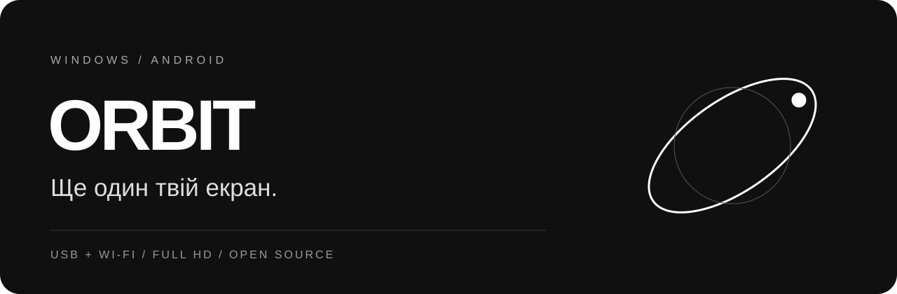

<strong>Простір Windows. На твоєму Android.</strong> USB · Wi-Fi · Full HD · Windows 10/11 × Android 8+

<a href="https://github.com/krekerhihle/orbit-display/releases/latest"><strong>Завантажити Orbit 0.4</strong></a> · <a href="docs/CONNECT-UA.md">Як підключити</a> · <a href="BUILD.md">Зібрати самостійно</a>

---

## Один ноутбук. Більше місця.

Orbit перетворює телефон або планшет на додатковий екран Windows. Відкрий чат, документацію чи ще одне вікно поруч з основним робочим столом. Чорно-білий майстер проведе від підключення кабелю до запуску екрана.

| Для роботи | Для зручності |
| :--- | :--- |
| Другий робочий стіл через віртуальний дисплей | Екран ліворуч, праворуч, зверху або знизу |
| 1920 × 1080 та режими, які надає драйвер | Звичайне вікно програми, змінний розмір |
| USB-A / USB-C з передаванням даних, Wi-Fi | Інсталятор із вибором папки |
| H.264: NVIDIA NVENC → Intel Quick Sync → x264 | Дотик, клавіатура, текстовий буфер за дозволом |
| GPU-захоплення, JPEG / GDI для сумісності | Автоматична перевірка оновлень на обох пристроях |

## Почни за чотири кроки

1. **Встанови.** У [Releases](https://github.com/krekerhihle/orbit-display/releases/latest) завантаж Windows **Setup.exe** та Android **.apk**. На ПК обери папку; на телефоні відкрий APK. Для переходу з 0.3 онови обидві програми один раз вручну.
2. **З'єднай.** Підключи USB-кабель, увімкни налагодження USB на Android та підтвердь доступ своєму ПК. Натисни **Перевірити USB**. Або вибери спільну Wi-Fi-мережу.
3. **Налаштуй.** Для окремого робочого столу встанови віртуальний драйвер через кнопку в майстрі. Обери додатковий дисплей, 1920 × 1080 і його розташування. Почни з H.264 та Авто до 60 FPS.
4. **Запусти.** Почни сеанс на ПК, введи код на Android і порівняй відбиток сертифіката. Готово — перенеси вікно на другий екран.

[Детальна інструкція та вирішення проблем →](docs/CONNECT-UA.md)

## Нове у 0.4

- **Менше зайвої роботи.** Незмінені кадри не кодуються постійно. GPU-захоплення пропускає відсутні оновлення; у статичному сеансі залишається періодичне оновлення раз на секунду.
- **Підтримка NVIDIA.** NVENC використовує відеокарту для H.264 і перетворення RGB. Intel Quick Sync та x264 залишаються резервними шляхами.
- **Коротка черга.** До чотирьох кадрів H.264 для запуску апаратного декодера, до двох JPEG. Черга не росте безмежно; повільний клієнт стримує відправлення.
- **Оновлення з GitHub.** Перевірка під час запуску й кожні п'ять хвилин роботи програми. Завантаження у фоні, RSA-підпис опису релізу та SHA-256 файлів. ПК пропонує встановлення кнопкою; Android просить системне підтвердження. Активний сеанс не переривається встановленням.
- **Виправлені USB-повідомлення.** Український текст відображається без пошкодженого кодування.

## Продуктивність без вигаданих цифр

120 Гц дисплея не означає 120 кадрів потоку. Ручний вибір вищої частоти доступний, але фактичні FPS залежать від захоплення, кодера, кабелю/мережі та телефона. Для першого запуску рекомендовано USB + H.264 + Авто до 60 FPS.

Профілі Full HD, 1600 × 900 і 1280 × 720 перевірено локальним кодуванням і декодуванням. Результати та межі перевірки — у [VALIDATION.md](VALIDATION.md). Стабільні 1080p120 та нульова затримка не заявляються; фізичний Samsung S23 після цих змін ще не перевірений.

## Корисно знати

Справжнє розширення потребує віртуального дисплея. Без нього можна явно вибрати дублювання основного екрана. Драйвер встановлюється окремо з майстра. Bluetooth, звук, DRM-відео й захищений екран Windows/UAC не підтримуються.

Трафік локального сеансу захищено TLS. Обмін буфером вимкнений, доки ти його не дозволиш. GitHub використовується для отримання оновлень; зображення екрана туди не надсилається. Оновлення перевіряються лише коли Orbit відкритий; без інтернету локальне підключення продовжує працювати.

Windows EXE та інсталятор не мають Authenticode-підпису. APK підписаний тим самим локальним ключем, що й попередні випуски. Підпис опису оновлення — окремий механізм перевірки релізу.

## Відкритий код

[GPL-3.0](LICENSE) · [Залежності та ліцензії](THIRD_PARTY.md) · [Інструкція збірки](BUILD.md) · [Історія змін](CHANGELOG.md)

Проблему можна описати в [Issues](https://github.com/krekerhihle/orbit-display/issues): версії Windows/Android, модель GPU, USB чи Wi-Fi, профіль та лічильник FPS. Не додавай PIN, сертифікати або зображення з приватними даними.
